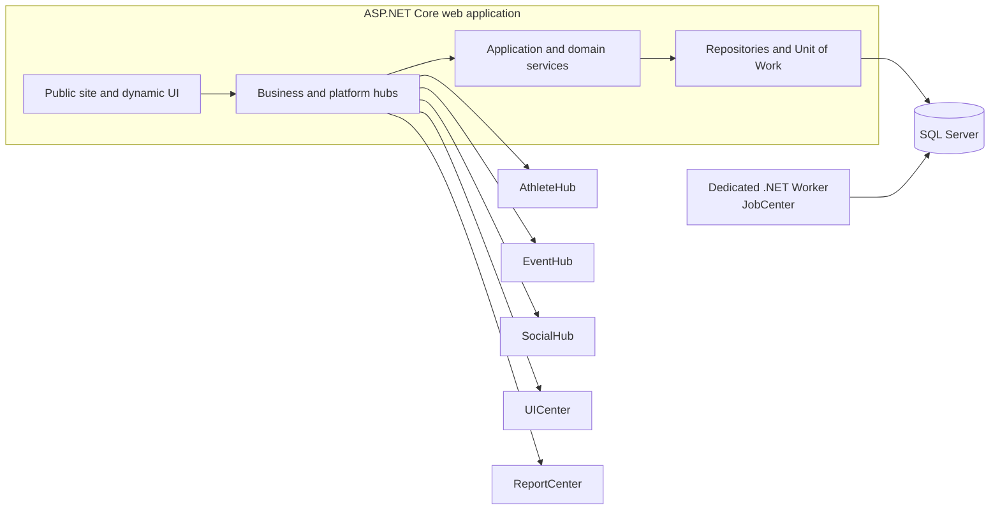

# Architecture map

Logical view of the application modules and the independently hosted background worker.

The worker runs as a separate service and uses the configured SQL Server connection; the diagram does not imply a specific queue technology.
